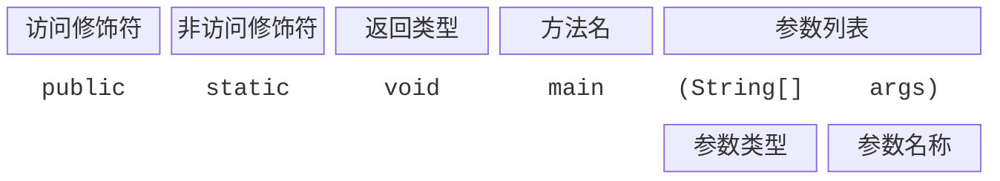
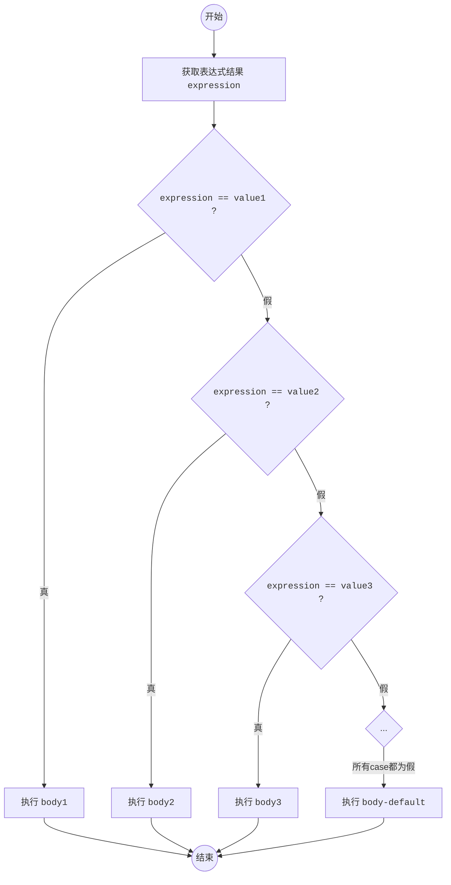

# Course 1 - Java 基础语法速通

> [!NOTE]
> 本文档并没有涉及所有的 Java 语句用法，只是择其重点，且内容比较杂。若想详细学习 Java，建议自己到网上寻找更多详细教程。

## 1 第一个 Java 程序

下面看一个简单的 Java 程序，它将输出字符串 `Hello World`。

```java
// 文件名： HelloWorld.java
public class HelloWorld {
    /* 第一个Java程序
     * 它将输出字符串 Hello World
     */
    public static void main(String[] args) {
        System.out.println("Hello World");  // 输出 Hello World
    }
}
```

我们可以分析一下这段代码：

1. **文件名**：源文件名必须和类名相同，文件名和类名不相同会导致编译错误。文件的后缀为 `.java`。切记 Java 是**大小写敏感**的，也就是说 `hello` 和 `Hello` 是不同的。
2. **类名**：所有类名的首字母都应该大写。如果类名由若干单词组成，那么每个单词的首字母应该大写（大驼峰命名），例如 `MyFirstJavaClass`。
3. **方法名**：所有的方法名的首字母都应该小写。如果方法名含有若干单词，则后面的每个单词首字母大写（小驼峰命名）,例如 `myFirstMethod`。
4. **主方法入口**：所有的 Java 程序由 `public static void main(String[] args)` 方法开始执行。



## 2 变量

变量是存储某个类型的数据的有名字的容器。

### 2.1 基本数据类型

Java 内置的数据类型有很多种，可以大致分为几大类：整数，小数，字符，布尔值：

1. **整数**：包括 `byte`、`short`、`int`、`long`。可储存的数字大小依次增加，相应地，占用的内存依次增多。自己编写程序时往往不会考虑内存问题，通常用 `int` 作为整数类型。
2. **小数**：包括 `float`、`double`。精度依次增加，相应地，占用的内存依次增多。自己写程序时，通常用 `double` 作为小数类型。
3. **字符**：`char`。储存一个单一的 16 位 Unicode 字符。
4. **布尔值**：`boolean`。只有两个取值：`true` 和 `false`。

这些基本数据类型不被视为对象储存。

在此之外，`String` 是任意长度的字符串，但它并不是基本数据类型，因此其实例被视为对象储存。

### 2.2 变量声明

```
type identifier [= value][, identifier [= value] ...] ;
```

- `type`：数据类型。
- `identifier`：变量名。变量名仅可使用以下字符：`a-z`、`A-Z`、`0-9`、`$`以及`_`，并且不能以数字开头。

在声明变量是，可以使用逗号 `,` 隔开来声明多个同类型变量。

在声明一个变量时，可以为它加上初始值，也可以不加（不加初始值默认为 `0`、`null`、`false` 等）。

```java
int a = 3;  // 声明变量a，类型为int，初始值为3
double b;  // 声明变量b，类型为double，不赋予初始值
```

想要修改变量时，不需要再写数据类型。

```java
a = 4;  // 把变量a修改为4
```

除此之外，还有参数变量，静态变量，局部变量等概念，这里不再赘述，读者可自行了解。

### 2.3 常量声明

在语句最前面加上 `final` 关键词，通常与 `static` 关键词一起使用（表示该常量属于类而不属于对象）。

```java
static final int MAX_SIZE = 100;
```

注意常量命名时用**全大写字母**（虽然不这么做也不会报错，但是出于代码规范，强烈建议全大写）。

## 3 循环

### 3.1 `while`

```java
while ( condition ) {
    // 循环体
}
```

只要 `condition` 语句结果为 `true`，循环就会一直执行下去。

例如这个累加的代码：

```java
public class Test {
    public static void main(String[] args) {
        int x = 10;
        while (x < 20) {
            System.out.print("value of x : " + x);
            x++;  // 等价于 x = x + 1
            System.out.print("\n");
        }
    }
}
```

以上实例编译运行结果如下：

```
value of x : 10
value of x : 11
value of x : 12
value of x : 13
value of x : 14
value of x : 15
value of x : 16
value of x : 17
value of x : 18
value of x : 19
```

### 3.2 `do-while`

`do-while` 循环和 `while` 循环相似。不同的是，对于 `while` 语句而言，如果不满足条件，则不能进入循环；而 `do-while` 语句至少会执行一次循环体，即使条件不满足。

```java
do {
    // 循环体
} while ( condition );
```

如果条件的值为 `true`，则语句块一直执行，直到布尔表达式的值为 `false`。

> [!TIP]
> 因为条件在循环体的后面，所以语句块在检测条件之前已经执行了。

### 3.3 `for`

```java
for (init; condition; update) {
    // 循环体
}
```

`for` 循环的执行顺序如下：

1. 执行初始化步骤（`init`），用来初始化循环控制变量。在初始化时仅可声明一种变量类型，但可初始化一个或多个循环控制变量，也可以是空语句。
2. 检测条件结果（`condition`）。如果为 `true`，循环体被执行。如果为`false`，循环终止，开始执行循环体后面的语句。
3. 执行更新步骤（`update`），用来更新循环控制变量。
4. 跳转到第2步继续。

以下是一个常见的 `for` 循环，其中循环体被执行10次：

```java
public class Test {
    public static void main(String[] args) {
        for (int x = 0; x < 10; x++) {
            System.out.print("value of x : " + x );
            System.out.print("\n");
        }
    }
}
```

输出：

```
value of x : 0
value of x : 1
value of x : 2
value of x : 3
value of x : 4
value of x : 5
value of x : 6
value of x : 7
value of x : 8
value of x : 9
```

`for` 循环还有一种加强写法，用于遍历可迭代对象（如数组）：

```java
for (element : iterable) {
    // 循环体
}
```

以下是一个例子，循环遍历了一个数组：

```java
public class Test {
    public static void main(String[] args) {
        int[] numbers = {10, 20, 30, 40, 50};

        for (int x : numbers){
            System.out.print(x);
            System.out.print(",");
        }
    }
}
```

输出

```
10,20,30,40,50,
```

### 3.4 `break` 与 `continue`

`break` 主要用在循环语句或者 `switch` 语句中，用来跳出整个语句块。`break` 的用法很简单，就是循环结构中的一条语句：

```java
break;
```

示例：

```java
public class Test {
    public static void main(String[] args) {
        int[] numbers = {10, 20, 30, 40, 50};

        for (int x : numbers) {
            if (x == 30) {
                // x 等于 30 时跳出循环
                break;
            }
            System.out.print( x );
            System.out.print("\n");
        }
    }
}
```

`continue` 适用于任何循环控制结构中。作用是让程序立刻跳转到下一次循环的迭代。

在 `for` 循环中，continue 语句使程序立即跳转到更新语句。

在 `while` 或者 `do-while` 循环中，程序立即跳转到布尔表达式的判断语句。

```java
public class Test {
    public static void main(String[] args) {
        int[] numbers = {10, 20, 30, 40, 50};

        for (int x : numbers) {
            // 当x=30时，直接跳到下一次循环
            if (x == 30) {
                continue;
            }
            System.out.print(x);
            System.out.print("\n");
        }
    }
}
```

## 4 条件

### 4.1 `if`

```java
if ( condition ) {
   // 如果 condition 结果为 true 将执行的语句
}
```

`if` 语句后面可以跟 `else` 语句。当 `if` 语句的条件结果为 `false` 时，`else` 语句块会被执行。

```java
if ( condition ) {
   // 如果 condition 的结果为 true
} else {
   // 如果 condition 的结果为 false
}
```

当然，也有 `else if` 语句。注意，若先前的判断有 `true`，则不会执行后面的 `else if` 判断。任何 `else` 和 `else if` 语句只会在先前所有判断都为 `false` 时执行。

以下是一个简单的例子：

```java
public class Test {
    public static void main(String args[]) {
        int x = 30;

        if (x == 10) {
            System.out.print("Value of X is 10");
        } else if (x == 20) {
            System.out.print("Value of X is 20");
        } else if (x == 30) {
            System.out.print("Value of X is 30");
        } else {
            System.out.print("以上都不是");
        }
    }
}
```

### 4.2 `switch-case`

`switch-case` 语句判断一个变量与一系列值中某个值是否相等，每个值称为一个分支。

```java
switch (expression) {
    case value1:
       // body1
       break;
    case value2:
       // body2
       break;
    ...
    default:
       // body-default
}
```

`switch-case` 基本原理如下：



- `switch` 语句可以拥有多个 `case` 语句。每个 `case` 后面跟一个要比较的值和冒号。
- `case` 语句中的值的数据类型必须与变量的数据类型相同，而且只能是常量或者字面常量。
- 当变量的值与 `case` 语句的值相等时，那么 `case` 语句之后的语句开始执行，直到 `break` 语句出现才会跳出 `switch` 语句。
- 当遇到 `break` 语句时，`switch` 语句终止。程序跳转到 `switch` 语句后面的语句执行。
- `case` 语句并非必须要包含 `break` 语句。如果没有 `break` 语句出现，程序会继续执行下一条 `case` 语句，直到出现 `break` 语句。
- `switch-case` 可以包含一个 `default` 分支，该分支一般是 `switch-case` 的最后一个分支（可以在任何位置，但建议在最后一个）。`default` 在没有任何一个 `case` 语句的值和变量值相等的时候执行。`default` 分支不需要 `break` 语句。

> [!IMPORTANT]
> `switch-case` 执行时，一定会先进行匹配，匹配成功返回当前 `case` 的值，再根据是否有 `break`，判断是否继续输出，或是跳出判断。**

以下是一个例子：

```java
public class Test {
    public static void main(String args[]) {
        char grade = 'C';

        switch (grade) {
            case 'A':
                System.out.println("优秀"); 
                break;
            case 'B':
            case 'C':
                System.out.println("良好");
                break;
            case 'D':
                System.out.println("及格");
                break;
            case 'F':
                System.out.println("你需要再努力努力");
                break;
            default:
                System.out.println("未知等级");
            }
        System.out.println("你的等级是 " + grade);
    }
}
```

以上代码编译运行结果如下：

```
良好
你的等级是 C
```

如果 `case` 语句块中没有 `break` 语句时，匹配成功后，从当前 `case` 开始，后续所有 `case` 的值都会输出。

```java
public class Test {
    public static void main(String args[]) {
        int i = 1;
        switch (i) {
            case 0:
                System.out.println("0");
            case 1:
                System.out.println("1");
            case 2:
                System.out.println("2");
            default:
                System.out.println("default");
        }
    }
}
```

以上代码编译运行结果如下：

```
1
2
default
```

> [!IMPORTANT]
> - 除非特意设计，一定要记得在 `case` 末尾加上 `break`;
> - 无论是否有 `default` 的处理逻辑，**都建议加上 `default` 分支**，哪怕里面是空的