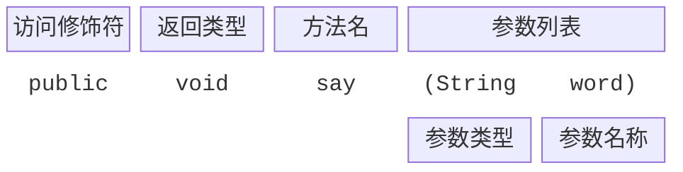
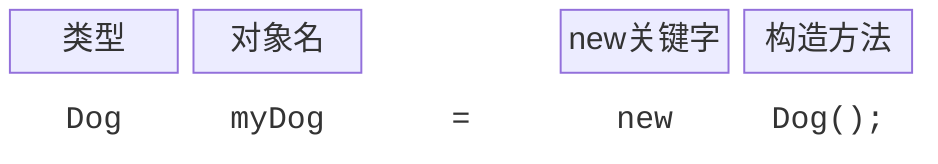

# Course 2 - 对象和类

## 1 概念

### 1.1 面向过程 vs. 面向对象

编程语言经常以其主要**编程范式**（Programming paradigm）来分类。最常见的两种编程范式是**面向过程**（Procedural Programming）和**面向对象**（Object-Oriented Programming, OOP）。

面向过程和面向对象的主要区别在于它们看待问题的方式：

- 面向过程将问题的解决方法当成是一个固定的流程，要按**步骤**完成，每一步就是一个过程。比如做菜：先放油，接着是放菜进去炒，然后放水，最后菜就做好了。这里面放油，炒，放水就是三个步骤。
- 面向对象将问题拆解成独立的部分（即**对象**），并对每部分分别建模（即**类**），最后将各部分组合起来解决问题。比如打电话：双方的手机可以看作两个相似的部分，而通信卫星可以看作另一个部分。分别对手机和卫星建模之后，再将它们组合起来就能解决问题。

### 1.2 何时创建面向对象的程序

​简单的编程任务可以用简单的单个流程来实现。然而，随着任务的规模和复杂度的增加，单个流程会变得更加复杂和难以管理。这时可以将复杂流程分解成较简单的流程的组合。即便如此，随着任务复杂度的持续增加，设计和管理流程之间的关系也会变得困难和容易出错。这种情况下，你可以考虑面向对象的程序设计。

​同时，对某些问题来说，从对象的角度来考虑解决办法会更简单、更自然：将问题陈述中的名词视为要定义的对象，动词视为要执行的操作，就可以将大问题拆解成如何对不同对象建模的小问题。

### 1.3 对象和类

- **对象**（Object）：对象是类的一个**实例**（Instance），有状态和行为。
- **类**（Class）：类是一个模板，它描述一类对象的行为和状态。

#### 1.3.1 对象和类的区别

对象是具体的，包含该对象特定**属性值**和**方法**。

类是抽象的（相对于对象而言），只定义一类对象**可以有的属性和方法**，不定义**每个对象特定的**属性值和方法。

对象可以被想象成一个具体的物体，类可以被想象成将一类物体抽象提炼出一个概念。比如你笔盒里有一支短铅笔、另有一支钝铅笔，他们都从属于铅笔这一概念。铅笔这个概念描述了一种呈条形，有石墨和粘土构成的铅芯和木制的外壳，可以在纸上写字的物体，但是铅笔作为**概念**是没有这些**物质性**的特征的。（你不能手握一个虚无缥缈的概念来书写，对吧？）这就是类与对象的差别。在这个例子中，铅笔是类，一支短铅笔和另一支钝铅笔是两个对象。

#### 1.3.2 对象和类的关系

对象是类的一个实例。我们也可以用真实世界的例子来理解编程中的对应概念。

拿一条大黄来举例，大黄是一个**对象**，它的名字叫大黄，是中华田园犬，毛色黄白相间，遇到陌生的人会大声叫，遇到认识的人会摇尾巴，跑得也很快。但**狗**是一个**类**，代表一个能被主人取名，有不同品种，不同毛色，会叫，会摇尾巴，会跑的物种。

我们借此理解编程中的概念。在编程中，**不同对象也有各自不同的状态和行为**。软件对象的状态就是**属性**（Attribute），行为就是**方法**（Method）。

## 2 Java 中的类

类可以看成是创建 Java 对象的模板。下面是一个简单的狗类定义。

```java
public class Dog {
    String breed;
    int size;
    String colour;
    int age;
 
    void eat() {}
 
    void run() {}
 
    void sleep() {}
 
    void name() {}
}
```

一个类可以包含以下类型变量：

- **局部变量**（Local variable）：在方法、构造方法或者语句块中定义的变量被称为局部变量。变量声明和初始化都是在方法中，方法结束后，变量就会自动销毁。
- **成员变量**（Member variable）：成员变量是定义在类中，方法体之外的变量。这种变量在创建对象的时候实例化。成员变量可以被类中方法、构造方法和特定类的语句块访问。
- **类变量**（Class variable）：类变量也声明在类中，方法体之外，但必须声明为 `static` 类型。

一个类可以拥有多个方法，在上面的例子中：`eat()`、`run()`、`sleep()` 和 `name()` 都是 `Dog` 类的方法。

接下来，我们来详细介绍类的具体定义方式

### 2.1 声明一个类

```java
public class Dog {
    // code here
}
```

这句代码表示声明了一个类，名字为 `Dog`，可全局访问，其内部的方法在大括号里面编写。

### 2.2 定义一个方法

```java
public class Dog {
    public void say(String word) {
        System.out.println(word);
    }
}
```

这句代码往狗类里面加入了一个 `say` 的方法，可以让小狗说话，我们来仔细看看这个方法：



- **访问修饰符**（Access modifier）：表示该方法允许被使用的范围（访问权限）。`public` 表示可全局访问。具体可参见[补充部分](#2.7)
- **返回类型**（Return type）：表示该方法返回值的类型（如 `int`, `String`, `void`......），决定方法内 `return` 语句返回的数据类型。`void` 表示方法不返回任何值，其 `return` 语句可省略或仅写 `return;`。
- **方法名**（Method name）：方法的名字。
- **参数**（Paramters）：执行这个方法需要提供的变量。传入的变量在方法中会作为局部变量储存。

所以，`say` 函数是一个可被全局访问，接受一个字符串参数，并不返回任何东西的方法。

### 2.3 成员变量

我们往狗类中加入一个成员变量：年龄 `age`。

```java
public class Dog {
    int age;  // 年龄

    public void say(String word) {
        System.out.println(word);
        System.out.println("I'm " + this.age + " years old")
    }

    public void grow() {
        this.age += 1;
    }
}
```

这个代码展示了如何定义一个成员变量，并在方法里使用。需要注意，如果一个方法内有同名的局部变量和成员变量，在访问成员变量时需要加上 `this` 关键字：

```java
public class Dog {
    private int age;  // 年龄

    public void say(String word) {
        System.out.println(word);
    }

    public void setAge(int age) {
        this.age = age;
    }

    public int getAge() {
        return this.age;
    }
}
```

### 2.4 实例化（Instantiate）一个类（创建对象）

```java
public class Test {
    public static void main(String[] args) {
        Dog myDog = new Dog();  // 创建对象
        myDog.say("Hello!");
        myDog.age = 3;
    }
}
```

实例化对象的语法有点类似变量声明：



- 类型：对象的类型，即对象对应的类。
- 对象名：对象的名字。
- `new` 关键字：表明需要创建一个对象。
- **构造方法**（Constructor）：使用构造函数创建对象。

对象创建之后，我们可以使用 `对象.方法()` 来调用其方法，以及使用 `对象.成员变量` 来访问和修改其成员变量。

### 2.5 构造方法

每个类都有构造方法。如果没有显式地为类定义构造方法，Java 编译器将会为该类提供一个默认的无参数构造方法。**构造方法的名称必须与类同名**，一个类可以有多个构造方法。构造方法在一个对象被使用 **`new` 关键字创建时立刻被调用**。

```java
public class Dog {
    int age;
    String name;

    public Dog(String name) {
        this.name = name;
        this.age = 1;
    }

    public void say(String word) {
        System.out.println(word);
        System.out.println("I'm " + this.age + " years old")
    }
    
    public void grow(){
        this.age += 1;
    }
}
```

我们定义了一个构造方法 `public Dog (String name)`，可以在创建对象时就为小狗赋予名字，并设置年龄为1岁。

> [!IMPORTANT]
> 构造方法不定义返回值。

加入构造方法后，我们创建对象的代码就需要相应地做出改变。

```java
public class Test {
    public static void main(String[] args) {
        Dog myDog = new Dog("Lucky");  // 使用构造方法创建对象
    	myDog.say("Hello!");
    	myDog.age = 3;
    }
}
```

传入的 `"Lucky"` 是构造方法的参数。也就是说，在创建对象的这一行里，构造方法被调用了。

### 2.6 成员变量的保护

如果，我们写的代码就像这个狗类直接发布给大众，绝对有可能会对我们的类进行这样的篡改。

```java
public class Test {
    public static void main(String[] args) {
        Dog myDog = new Dog("Lucky");
    	myDog.age = 99999;
    }
}
```

我们当然不希望这种事情发生，所以需要对成员变量进行保护。

我们可以把成员变量的访问权限设置为 `private`，这样其他类的代码就无法直接通过 `对象.成员变量` 访问成员变量了。为了仍能从别处读取成员变量的值，可以为他们设置专门的 `get` 方法，让变量**只读**（Read-only）。

```java
public class Dog {
    private int age;
    private String name;

    public void Dog(String name) {
        this.name = name;
        this.age = 1;
    }
    
    public void say(String word) {
        System.out.println(word);
        System.out.println("I'm " + this.age + " years old")
    }
    
    public void grow() {
        this.age += 1;
    }
    
    public int getAge() {
        return this.age;
    }
    
    public int getName() {
        return this.name;
    }
}
```

这样，我们只能调用 `myDog.getAge()` 来读取变量，而无法修改他。

这种操作叫做**封装**（Encapsulation），只能通过定义好的 `get/set` 方法（Getter/Setter）来访问变量，来保护一些变量防止被恶意修改。

```java
public class Dog {
    private String name;
    
    public void setName(String name) {
        this.name = name;
    }
    
    public int getName(){
        return this.name;
    }
}
```

以上代码针对 `name` 这一变量展示了完整的封装。

### 2.7 补充：访问修饰符

在 Java 中，可以使用访问控制符来对类、变量和方法的访问权限进行限制。Java 支持4种不同的访问权限：

- `public`：对所有类可见。使用对象：类、接口、变量、方法。
- `protected`：对同一**包**（Package）内的类和所有子类可见。使用对象：变量、方法。**不能用于修饰外部类。**
- `default`（即默认，不使用任何修饰符）：在同一包内可见。使用对象：类、接口、变量、方法。
- `private`：在同一类内可见。使用对象：变量、方法。**不能用于修饰外部类。**

我们可以通过以下表来说明访问权限：

| 修饰符      | 当前类 | 同包内 | 子类（同包） | 子类（不同包） | 其他包 |
|-|-|-|-|-|-|
| `public`    | Y      | Y        | Y              | Y              | Y      |
| `protected` | Y      | Y        | Y              | Y              | N      |
| `default`   | Y      | Y        | Y              | N              | N      |
| `private`   | Y      | N        | N              | N              | N      |

---

## 类之间的关系

> 理论上，目前为止你就可以直接进行机器人编写，以下关于继承，重写等的操作在机器人实际编写中使用不多。不过我仍然建议你了解一下以下内容。

### 继承

#### 1.概念

继承就是子类继承父类的特征和行为，使得子类对象（实例）具有父类的实例域和方法，或子类从父类继承方法，使得子类具有父类相同的行为。以下是便于理解的一个例子:


在实际编程中，我们可以把几个功能有重复，或者有相关性的类抽象出一个**父类**，并让**子类**分别继承**父类**，可以提高维护性，代码也更加简洁，提高代码的复用性。

#### 2.Java代码

```Java
class 父类 {
}
 
class 子类 extends 父类 {
}
```

当子类继承这个父类之后，就具有父类当中的属性和方法，子类就不会存在重复的代码。

例如：有一个汽车类和巴士类

```java
public class Car{
	private String name;
    public Car(String name){
        this.name = name;
    }
    public void drive(){
        System.out.println(name+"开车了"); 
    }
}
```

```java
public class Bus{
	private String name;
    public Bus(String name){
        this.name = name;
    }
   	public void drive(){
        System.out.println(name+"开车了"); 
    }
    public void pay(){
        System.out.println("你坐上了公交车，付钱！"); 
    }
}
```

那么我们可以提炼出一个父类Vehicle类

```java
public class Vehicle{
	private String name;
    public Vehicle(String name){
        this.name = name;
    }
    public void drive(){
        System.out.println(name+"开车了"); 
    }
}
```

那么Car类与Bus类就可以这样写

```java
public class Car extends Vehicle{
	public Car(String name){
    	super(name);
    }
}
```

```java
public class Bus extends Vehicle{
	public Bus(String name){
        super(name);
    }
    public void pay(){
        System.out.println("你坐上了公交车，付钱！"); 
    }
}
```

**注意**：super关键字指向父类，相当于父类的this。super()方法则表示调用父类构造函数。

#### 3. 方法的重写(Override)

重写是在继承关系的基础上，重写父类已有的方法，写成一个子类的新方法。在调用子类的该方法时，使用子类的方法而不是父类的方法。

继续以上面的车子的代码为例，以下是重写的一个例子，你可以体会一下其作用：

```java
public class Bus extends Vehicle{
	public Bus(String name){
        super(name);
    }
    
    @Override
    public void drive(){                         // 重写了父类的drive()方法
        System.out.println(name+"开车了，开的很慢"); 
    }
    
    public void pay(){
        System.out.println("你坐上了公交车，付钱！"); 
    }
}
```

这时在使用Bus类的drive方法，就会输出 "开车了，开的很慢"

### 抽象与实现

#### 1.抽象类

在面向对象的概念中，所有的对象都是通过类来描绘的，但是反过来，并不是所有的类都是用来描绘对象的，如果一个类中没有包含足够的信息来描绘一个具体的对象，这样的类就是抽象类。抽象类除了不能实例化对象之外，类的其它功能依然存在，成员变量、成员方法和构造方法的访问方式和普通类一样。由于抽象类不能实例化对象，所以抽象类必须被继承，才能被使用。也是因为这个原因，通常在设计阶段决定要不要设计抽象类。

省流：**抽象类**可以不写方法的具体**实现**，只规范他有些什么方法，需要在后续代码中**实现**或**重写**

在Java中，用abstract关键字来声明一个抽象类/函数

```java
public abstract class Vehicle{
    private String name;
    public Vehicle(String name){
        this.name = name;
    }
    // 这是一个抽象方法，在父类中，没有具体实现，需要每个子类各自实现这个方法
    public abstract void drive(){}
}
```

#### 2.重写

在实现中也非常简单，使用@Override关键词来重写方法就可以输入具体实现

```java
public class Bus extends Vehicle{
	public Bus(String name){
        super(name);
    }
    
    @Override
    public void drive(){                         // 实现了父类的drive()方法
        System.out.println(name+"开车了，开的很慢"); 
    }
    
    public void pay(){
        System.out.println("你坐上了公交车，付钱！"); 
    }
}
```

#### 3.接口

如果一个类里面全是抽象的方法，那就是一个**接口**，我们这样来定义一个接口

```java
[可见度] interface 接口名称 [extends 其他的接口名] {
        // 声明变量
        // 抽象方法
}
```

+ 接口不能有具体的方法**实现**，也就是说，方法的里面必须是空的（除了带有default的方法）！

+ 接口不能用来**实例化**！必须有其他类来**继承 **(implements)

+ 接口里面除了有default标明的方法，必须在继承时全部实现！

+ 接口可以多继承（同一个类可以继承多个接口）

我们可以把Vehicle抽象成一个接口，大概就像这样：

```java
public interface Vehicle{
    private String name;
    public void drive();
    public default void pay(){}// 不是所有的载具需要pay，所以若不实现就默认为空
}
```

那么Bus的代码就会变成这样：

```java
public class Bus implements Vehicle{
	public Bus(String name){
        super(name);
    }
    
    @Override
    public void drive(){                         // 实现了父类的drive()方法
        System.out.println(name+"开车了，开的很慢"); 
    }
    
    @Override
    public void pay(){
        System.out.println("你坐上了公交车，付钱！"); 
    }
}
```

那么抽象有什么优点呢，可以方便后续代码的调用和维护，比如**多态**。

### 多态

情景： 我们现在作为一个人，需要去乘坐这些载具了，我们可以自己开车，也可以做公交车（当然，还有很多出行方式）

那么，我们想要去使用载具的行为就像这样

```java
public class Person{
    Bus bus = new Bus("bus");
    Car car = new Car("car");
	public void go(String choice){
        switch(choice){
            case "Car":
                car.drive();
            case "Bus":
                bus.drive();
        }
    }
    public static void main(String[] args){
        go("Bus");
    }
}
```

你不难发现，这个代码如同答辩，因为每多增加一种出行方式，我们就要在switch例多写一个判断。没有可维护性。

但是如果我们让两个类继承自Vehicle类的话，我们就可以这样写。

```java
public class Person{
	public static void go(Vehicle vehicle){
        vehicle.drive();
        }
    }
	public static void main(String[] args){
        Bus bus = new Bus("bus");
        go(bus);
    }
}
```

Bus作为一个Vehicle的子类，可以作为这里参数的Vehicle类型直接传入，并调用driv()方法。

当然，如果有其他载具，只需要让他继承Vehicle类，不需要改变这里人的逻辑，增强了可延展性。

此外，如果不同载具的drive逻辑不同，只需要在继承时重写该方法即可，通过调用vehicle.drive()可以做到不同载具的不同逻辑，此处就不赘述了。

---

## 练习

以下是一个网上摘抄下来的简单的类，我已经好心地保留了注释，看看这个类有些什么功能

**Employee.java**

```java
import java.io.*;
 
public class Employee {
    private String name;
    private int age;
    private String designation;
    private double salary;
 
    // Employee 类的构造器
    public Employee(String name) {
        this.name = name;
    }
 
    // 设置 age 的值
    public void setAge(int age) {
        this.age = age;
    }
 
    // 获取 age 的值
    public int getAge() {
        return age;
    }
 
    // 设置 designation 的值
    public void setDesignation(String designation) {
        this.designation = designation;
    }
 
    // 获取 designation 的值
    public String getDesignation() {
        return designation;
    }
 
    // 设置 salary 的值
    public void setSalary(double salary) {
        this.salary = salary;
    }
 
    // 获取 salary 的值
    public double getSalary() {
        return salary;
    }
 
    // 打印信息
    public void printEmployee() {
        System.out.println(this);
    }
 
    // 重写 toString 方法
    @Override
    public String toString() {
        return "名字: " + name + "\n" +
               "年龄: " + age + "\n" +
               "职位: " + designation + "\n" +
               "薪水: " + salary;
    }
}
```

猜测一下在另一个文件的main方法里输入这些内容，会输出什么

**EmployeeTest.java**

```java
import java.io.*;
 
public class EmployeeTest {
    public static void main(String[] args) {
        // 使用构造器创建两个对象
        Employee empOne = new Employee("RUNOOB1");
        Employee empTwo = new Employee("RUNOOB2");
 
        // 调用这两个对象的成员方法
        empOne.setAge(26);
        empOne.setDesignation("高级程序员");
        empOne.setSalary(1000);
        empOne.printEmployee();
 
        empTwo.setAge(21);
        empTwo.setDesignation("菜鸟程序员");
        empTwo.setSalary(500);
        empTwo.printEmployee();
    }
}
```

[footnote-1]: #footnote-1
关于访问修饰符的介绍，见 *补充：访问修饰符
[^2]: 注意：参数变量有作用域，只能在方法内部使用
[^3]: 构造方法的名字必须和类名保持一致，然而可以利用参数的不同来实现多个构造方法，这涉及方法的重载(Overload)
[^4]: 这取决于基类是否在同一个包
